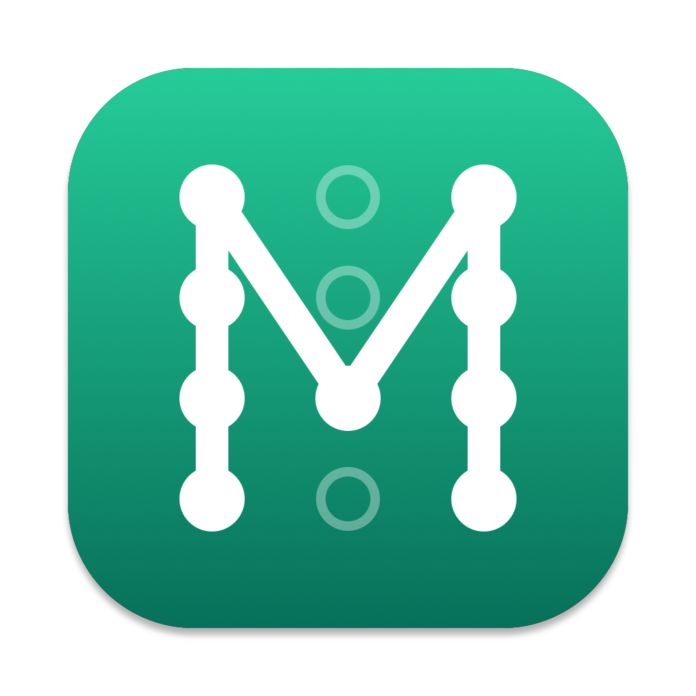

<p align="center"></p>

# MacroSIP

**English** · [Русский](README.ru.md)

[](https://github.com/HSMM/MacroSIP/actions/workflows/ci.yml)
[](LICENSE)


A MicroSIP-style SIP softphone for macOS on Apple Silicon and Intel. Native Swift and
SwiftUI interface, [PJSIP](https://github.com/pjsip/pjproject) 2.17 engine,
no Electron, no Qt. One small window, a menu bar icon, and everything a desk
phone does: several accounts, calls with transfer and conference, recording, contacts with
presence, quick keys, global hotkeys, English and Russian interface.

Guide: https://hsmm.github.io/MacroSIP/wiki/

Status: `26.3.0` released 2026-11-05. What comes next: [docs/ROADMAP.md](docs/ROADMAP.md).

## Screenshots

The app follows the macOS appearance; every picture below switches with it (light and dark
frames are in [docs/screenshots](docs/screenshots), English and Russian).

<p align="center">
  <picture><source media="(prefers-color-scheme: dark)" srcset="docs/screenshots/dark/dialpad-calls.png?v=3"></picture>
  <picture><source media="(prefers-color-scheme: dark)" srcset="docs/screenshots/dark/contacts-presence.png?v=3"></picture>
  <picture><source media="(prefers-color-scheme: dark)" srcset="docs/screenshots/dark/call-recording.png?v=3"></picture>
</p>

<p align="center">
  <picture><source media="(prefers-color-scheme: dark)" srcset="docs/screenshots/dark/conference.png?v=3"></picture>
  <picture><source media="(prefers-color-scheme: dark)" srcset="docs/screenshots/dark/directory-search.png?v=3"></picture>
</p>

Account pop-up: pick the outgoing account, switch accounts on and off. Light theme on the left, dark theme on the right:

<p align="center">
  
  
</p>

Settings: global hotkeys (Calls) and the Troubleshooting group with Debug mode (General › Advanced):

<p align="center">
  <picture><source media="(prefers-color-scheme: dark)" srcset="docs/screenshots/dark/settings-hotkeys.png?v=3"></picture>
  <picture><source media="(prefers-color-scheme: dark)" srcset="docs/screenshots/dark/settings-diagnostics.png?v=3"></picture>
</p>

<p align="center">
  <picture><source media="(prefers-color-scheme: dark)" srcset="docs/screenshots/dark/settings-recording.png?v=3"></picture>
</p>

Import from MicroSIP with a preview, and the incoming call window with auto-answer:

<table align="center"><tr>
<td valign="middle"><picture><source media="(prefers-color-scheme: dark)" srcset="docs/screenshots/dark/import-microsip.png?v=3"></picture></td>
<td valign="middle"><picture><source media="(prefers-color-scheme: dark)" srcset="docs/screenshots/dark/incoming-auto-answer.png?v=3"></picture></td>
</tr></table>

Messages: the conversation list, and a conversation open:

<p align="center">
  <picture><source media="(prefers-color-scheme: dark)" srcset="docs/screenshots/dark/messages-list.png?v=3"></picture>
  <picture><source media="(prefers-color-scheme: dark)" srcset="docs/screenshots/dark/messages-conversation.png?v=3"></picture>
</p>

## Features

**Calls**

- Up to four calls at once: answer, hold, mute, DTMF (automatic: RFC 2833 with a SIP INFO fallback; or RFC 2833 only, SIP INFO only, in-band), blind and attended transfer, local conference (merge includes held calls).
- A call-quality indicator from RTCP with a "poor connection" notice; speaker and microphone volume per call, ringtone volume.
- Incoming calls: a call window and a notification; a second call during a call is either announced with a short tone and a window (call waiting) or turned away with 486 Busy (single-call mode); optionally the main window comes to the front.
- Auto-answer: off, all calls or contacts only, after a delay; with your own PBX the `Call-Info: answer-after` header sets the delay.
- Reject incoming calls from nobody, everyone, numbers not in Contacts, or anonymous callers; Do Not Disturb, also for 30 minutes, 1 hour or until 9:00 tomorrow.
- Call log with playback of recordings; `sip:`, `sips:` and `tel:` links open in the app.

**Messages**

- Send and receive text messages over SIP `MESSAGE` (`text/plain`, UTF-8, Cyrillic included); SMS forwarded by Asterisk `chan_dongle` arrive as ordinary messages.
- Off by default: switch on "Text messages (SIP MESSAGE)" in Settings › General; until then there is no Messages tab and incoming messages are ignored.
- A Messages tab with conversations kept between launches; unread counts on the tab and the Dock icon, macOS notifications, and an optional sound (Settings › Audio › Sound events: New message).
- Each outgoing message shows its status: "Sent" means the SIP server or the peer accepted the message, not that a phone received it; "Not sent" shows the SIP reason, with Retry.
- "Send Message" in the Contacts and Call Log menus; up to 2800 bytes per message.
- Not included: group chat, attachments, typing indicators, end-to-end encryption.

**Accounts and network**

- Several SIP accounts registered at once; UDP, TCP and TLS with certificate verification; SRTP; STUN and ICE; outgoing-only accounts; each account switched on or off in the account pop-up; search and a status summary when there are many. Passwords are kept in the Keychain.
- An account on a server addressed by a private IP address (10.x, 172.16-31.x, 192.168.x, 100.64-127.x, on the LAN or over a VPN) does not use STUN, so the first REGISTER carries the Mac's own address.
- IPv6 next to IPv4: SIP over UDP, TCP and TLS and the audio over IPv6, for a server given by an IPv6 address or by a host name with IPv6 (AAAA) records. Per account, IP protocol Auto (an IP address picks its own protocol, a host name follows the order macOS returns), IPv4 only or IPv6 only. Over IPv6 there is no STUN; ICE works over IPv6 too.
- After a network drop, an IP change or sleep the accounts register again at once, with backoff while the network is down; a running call survives an IP change. The status bar and the call window show "No network" and "Reconnecting…".
- Network pane: RTP port range, rport, DNS SRV with a custom nameserver.
- Codecs: Opus (with FEC and DTX), G.722, G.711 and, off until you turn them on, G.722.1, GSM, iLBC and Speex.
- Voicemail indicator (MWI) per account: a badge in the status bar and a one-click call to the voicemail number.

**Contacts, presence and directory**

- Contact card with a photo, organization, several numbers with labels, email and notes; favorites; sort by first or last name; import from the macOS Contacts app.
- Presence: watch contacts and publish your own status (Available, Away, Do Not Disturb).
- Directory of users: LDAP, a URL (CSV or JSON), Google Contacts or the macOS Contacts app; suggestions in the number field, incoming callers looked up by number, search only or import into Contacts.

**Recording**

- Call recording to M4A (AAC), mono or stereo (you on the left channel, the caller on the right); automatic recording of all calls; the folder is yours to choose.
- An optional notice tone every few seconds that both sides hear.

**Quick keys and global hotkeys**

- Quick keys: up to 12 speed-dial keys with BLF in a panel beside or under the main window; types Call, DTMF, blind and attended transfer, add to conference; a click on a ringing key dials the pickup code; ⌘1 to ⌘9.
- Global hotkeys (off by default): answer, hang up and mute from any app, ⌃⌥A, ⌃⌥H and ⌃⌥M to start with, each one yours to change or clear; no system permission needed.

**Import from MicroSIP**

- Settings › Accounts › Import from MicroSIP…: accounts and contacts from `MicroSIP.ini` and `Contacts.xml` with a preview first. Imported accounts come in switched off and wait for their passwords (MicroSIP's cannot be read).
- For scripts and MDM: `/Applications/MacroSIP.app/Contents/MacOS/MacroSIP --import-microsip MicroSIP.ini [--contacts Contacts.xml] [--data-dir DIR] [--dry-run]`.

**Menu bar, Do Not Disturb, links**

- A menu bar icon with the registration state, quick dial, recent calls, Do Not Disturb, your status and voicemail; the app keeps working with the window closed.
- Launch at login; hide the Dock icon.

**Audio**

- Input, output and ringtone devices chosen separately; the app switches to a headset when it is connected and back when it is removed.
- Echo cancellation (with Apple's voice processing and noise suppression on the default devices, the built-in canceller for other devices).
- Hold music for the caller: a built-in melody, your own file, or none.
- USB headset buttons (answer, hang up, mute, redial) with indicator lights; sound events; an audio test with a microphone meter.

**Languages, themes, updates**

- Interface in English and Russian, light and dark themes.
- Updates inside the app with Sparkle: a check at launch and once a day, release candidates optional.
- A universal app for Apple Silicon and Intel.

## Installing

Requires macOS 14 or newer on Apple Silicon or Intel. The app and the DMG are universal
(one download for both architectures).

### With Homebrew

```sh
brew tap hsmm/tap
brew install --cask hsmm/tap/macrosip
```

### From the DMG

1. Download `MacroSIP-<version>.dmg` from the
   [latest release](https://github.com/HSMM/MacroSIP/releases/latest).
2. Open it and drag MacroSIP onto the Applications folder.
3. First launch: the app is signed ad hoc (not notarized), so macOS refuses to open it
   at first. Right-click MacroSIP in Applications and choose Open, then confirm, or run
   `xattr -dr com.apple.quarantine /Applications/MacroSIP.app` once.

### Updates

With Settings › General › Updates › "Check for updates automatically" on (the default), MacroSIP
checks a few seconds after launch and then once a day, and asks before installing an update.
MacroSIP › Check for Updates… checks right away. "Include release candidates" also offers test
builds of the next version. Updates are signed and verified by Sparkle before they are installed,
and the updated app opens without the first-launch prompt. A Homebrew install updates itself the
same way. Because the app is signed ad hoc, macOS asks for microphone access again after each
update; allow it once more.

## Troubleshooting

- The log is `~/Library/Logs/MacroSIP/MacroSIP.log` (three files of 2 MB, 8 MB each in Debug mode).
- Settings › General › Advanced › Troubleshooting:
  - **Open Log Folder** shows the log files in Finder.
  - **Copy Diagnostics** copies versions, accounts and settings, without passwords, to paste into a bug report.
  - **Debug mode** writes much more detail to the log, including SIP messages, with no restart; the log grows faster, so turn it off after you send the archive.
  - **Create Archive…** saves a ZIP with the log files, the diagnostics report and up to five recent MacroSIP crash reports. Passwords, digest responses, nonces and similar secrets are removed from the copies in the archive; phone numbers and server addresses stay, so send it only to someone you trust.
- From Terminal, `--log-level 0` to `6` sets the PJSIP verbosity (or the environment variable `MACROSIP_LOG_LEVEL`); an explicit level wins over the Debug mode switch:

  ```sh
  /Applications/MacroSIP.app/Contents/MacOS/MacroSIP --log-level 5
  log show --last 10m --predicate 'subsystem == "com.hsmm.macrosip"' --info
  ```
- A message shows Sent but the phone did not get it: "Sent" only means the server accepted the message. Delivery to a mobile depends on the server (chan_dongle, the modem, the carrier); check the Asterisk log.

Bugs and feature requests: https://github.com/HSMM/MacroSIP/issues

## Building

Requirements: macOS 14 or newer on an Apple Silicon Mac and the Xcode Command Line Tools.
A full Xcode and Homebrew packages are not needed: OpenSSL and Opus are built from pinned
sources together with PJSIP. The Intel (x86_64) half of the universal build is
cross-compiled on the same Mac.

```sh
git clone https://github.com/HSMM/MacroSIP.git
cd MacroSIP
scripts/build-pjsip.sh      # builds OpenSSL, Opus and PJSIP 2.17 for arm64 and x86_64 once (about 5 minutes)
swift build -c release      # builds the Swift packages (native architecture)
scripts/make-app.sh         # bundles a universal dist/MacroSIP.app (ad-hoc signed)
open dist/MacroSIP.app
scripts/make-dmg.sh         # optional: dist/MacroSIP-<version>.dmg
```

Builds are signed ad hoc, so on first launch macOS asks to confirm opening an
app from an unidentified developer. `scripts/make-app.sh debug` builds a native debug app that also takes
`--mock-engine --demo-state <name>` for screenshots and manual checks (see [docs/DEVELOPMENT.md](docs/DEVELOPMENT.md)).

### Tests

```sh
scripts/test.sh             # Swift Testing suites (unit tests and engine tests over loopback)
scripts/selftest-call.sh    # end-to-end call against a local pjsua: RTP both ways, hold,
                            # DTMF, recording and M4A conversion, presence, two-leg conference,
                            # incoming calls, transfers
```

## Releasing

The details are in [docs/DEVELOPMENT.md](docs/DEVELOPMENT.md#releasing).

1. Tag `26.3.0` (release candidates: `26.3.0-rc.1`) and push the tag; the app takes its version from the tag. For a final release also bump `Product.fallbackVersion`.
2. `.github/workflows/release.yml` builds the DMG, creates the GitHub Release and adds it to the
   update feed (`appcast.xml` on the `gh-pages` branch, signed with the Actions secret
   `SPARKLE_PRIVATE_KEY`; ADR 0013). Tag each release on a new commit, a final release after its
   candidate too.
3. The same workflow updates the Homebrew cask in `HSMM/homebrew-tap` with the `TAP_TOKEN` secret.
   In a fresh fork: create the public repository `HSMM/homebrew-tap`, a fine-grained personal access
   token with Contents read and write on that repository only, and store it as the Actions secret
   `TAP_TOKEN`. Without the secret the step is skipped.

## Project layout

| Path | What |
|---|---|
| `Sources/CPJSUA` | C shim over pjsua, the only place that includes PJSIP headers |
| `Sources/MacroSIPCore` | Engine (accounts, calls, conference, recording, presence), models, storage |
| `Sources/MacroSIPApp` | SwiftUI/AppKit application |
| `Sources/macrosip-cli` | Command-line phone used by the self-test and for debugging against a PBX; also takes `--import-microsip` |
| `docs/` | Roadmap, design docs, ADRs, UI spec and mockups |
| `scripts/` | PJSIP build, app bundling, DMG, icon, appcast, cask update, tests |
| `packaging/` | Entitlements, app icon, Homebrew cask template |
| `.github/workflows/` | CI and release workflows |

Design documents: [ROADMAP](docs/ROADMAP.md), [engine design](docs/ENGINE.md),
[UI spec](docs/design/SCREENS.md), [decisions](docs/adr/).

## Support the project

MacroSIP is free and open source. If it saves you time, you can support development with a donation. QR codes and preset amounts: [donate page](https://hsmm.github.io/MacroSIP/donate.html).

| Coin | Network | Address |
| --- | --- | --- |
| BTC | Bitcoin | `16GBSkVAY67ZbGdqxQE17vcZDiZdgn46Wf` |
| USDT | TRC-20 (Tron) | `TX2hHPpUKXnhCvMb8PWkjSUbnvQ2wxCJr1` |

## License

GPLv2 or later, because PJSIP is GPLv2+. See [LICENSE](LICENSE).
