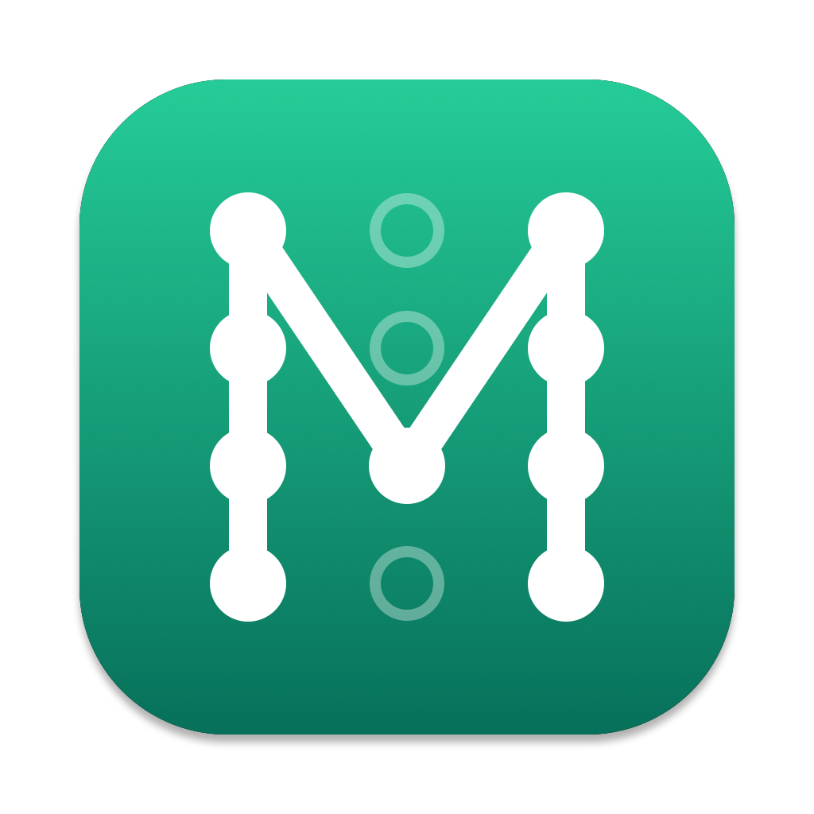
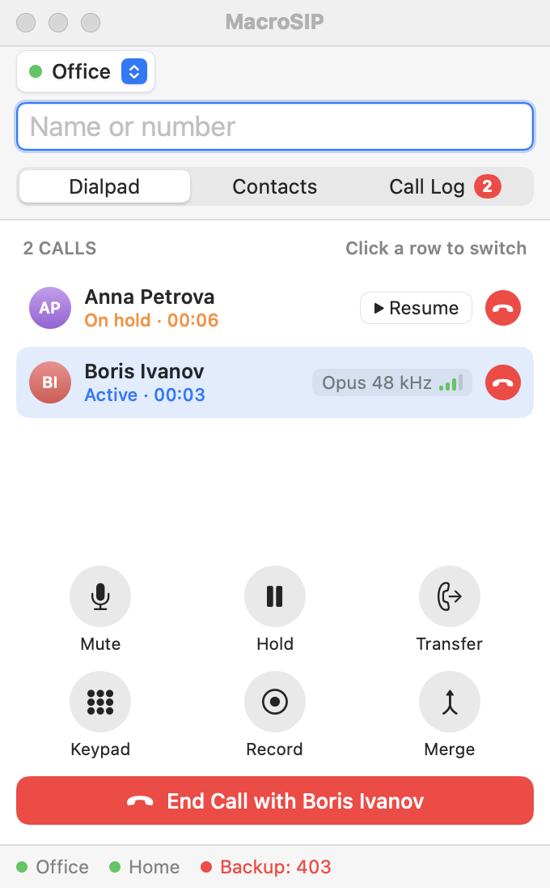
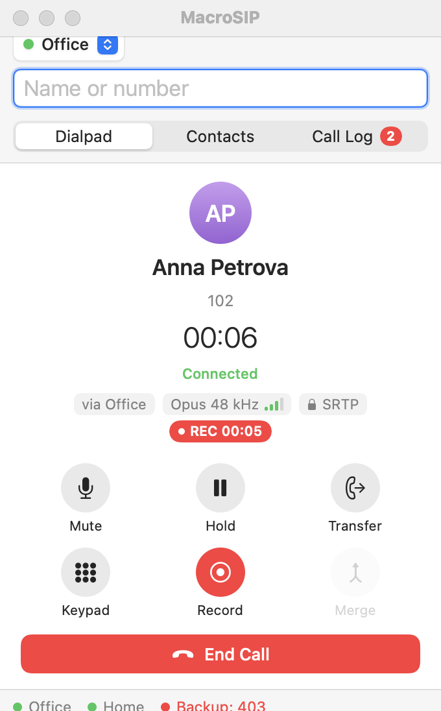
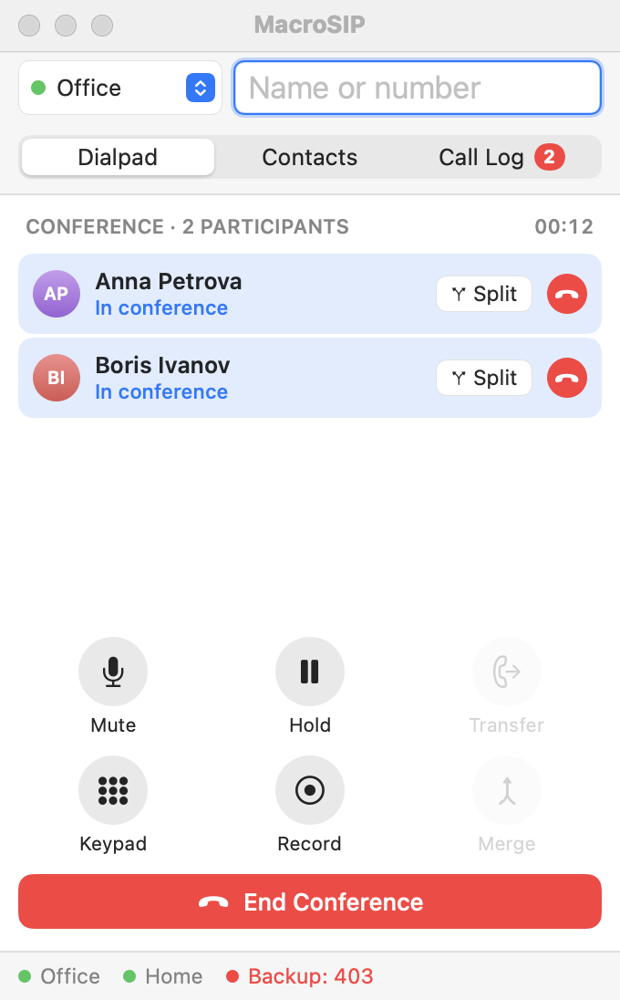
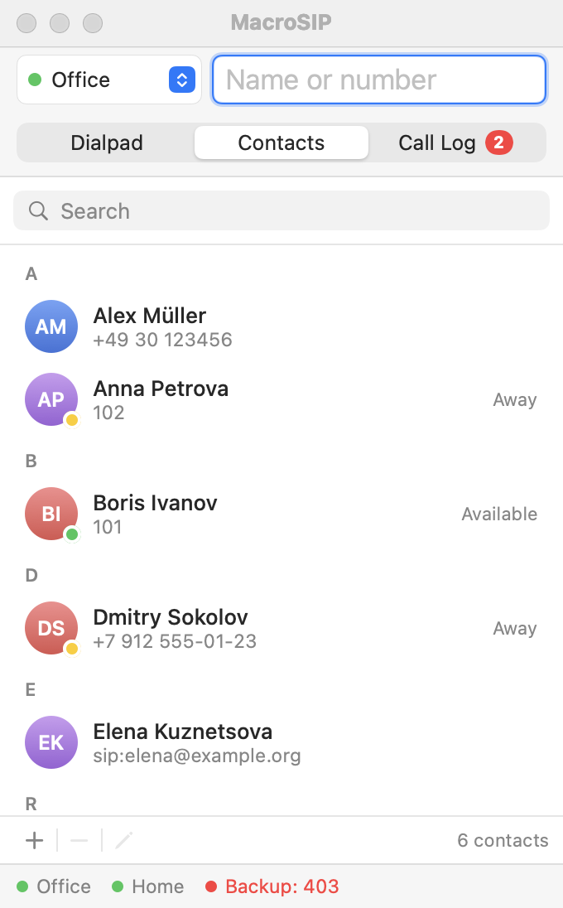
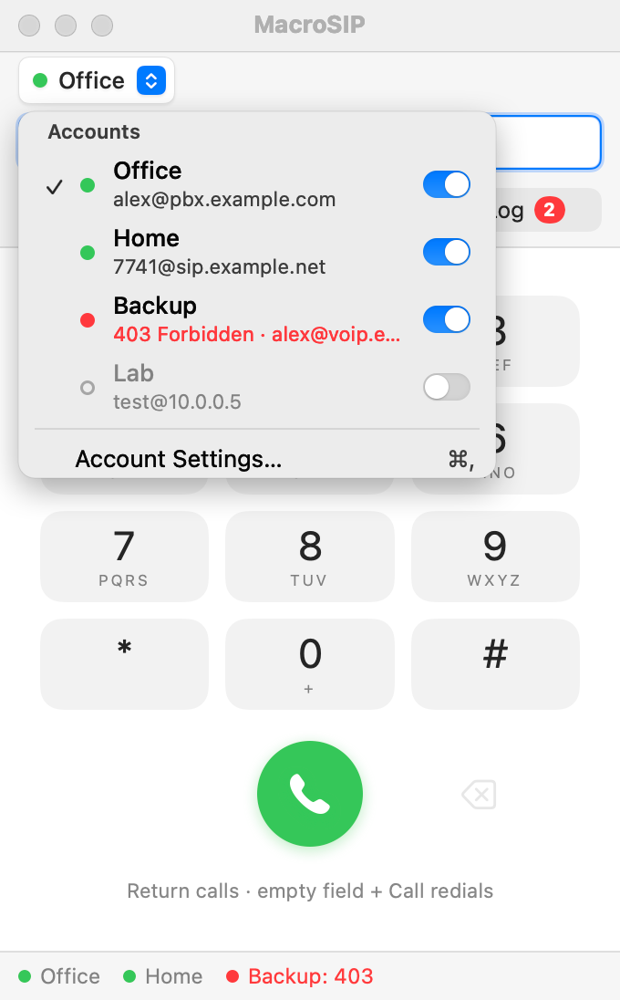
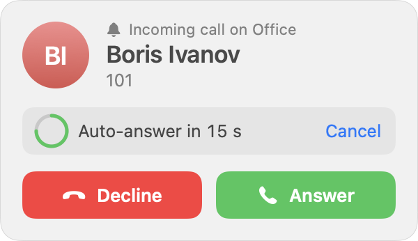

<p align="center"></p>

# MacroSIP

**English** · [Русский](README.ru.md)

[](https://github.com/HSMM/MacroSIP/actions/workflows/ci.yml)
[](LICENSE)


A MicroSIP-style SIP softphone for macOS on Apple Silicon. Native Swift and
SwiftUI interface, [PJSIP](https://github.com/pjsip/pjproject) 2.17 engine,
no Electron, no Qt. One small window, a menu bar icon, and everything a desk
phone does.

<p align="center">
  
  
  
</p>
<p align="center">
  
  
  
</p>

## Features

- Several SIP accounts registered at the same time; UDP, TCP and TLS with
  certificate verification; SRTP; STUN and ICE.
- Up to four simultaneous calls: answer, hold, mute, DTMF, blind and attended
  transfer, local conference.
- Call recording to M4A (AAC), manual or automatic.
- Auto-answer: off, all calls, contacts only, with a delay; honours
  `Call-Info: answer-after` from your own PBX only.
- Contact presence: see who is available, away or on the phone, and publish
  your own status (Available, Away, Do Not Disturb).
- Call history and contacts; `sip:`, `sips:` and `tel:` links open in the app.
- Menu bar icon with registration state, quick dial, recent calls and Do Not
  Disturb; the app keeps working with the window closed.
- Codecs: Opus, G.722, G.711 (PCMU/PCMA). Echo cancellation (WebRTC AEC).
- English and Russian interface. Launch at login, language switch (Settings › General), log file.

Status: `26.0.0` released. What comes next: [docs/ROADMAP.md](docs/ROADMAP.md).

## Installing

Requires macOS 14 or newer on Apple Silicon.

### With Homebrew

```sh
brew tap hsmm/tap
brew install --cask hsmm/tap/macrosip
```

### From the DMG

1. Download `MacroSIP-<version>.dmg` from the
   [latest release](https://github.com/HSMM/MacroSIP/releases/latest).
2. Open it and drag MacroSIP onto the Applications folder.
3. First launch: the app is signed ad hoc (not notarized), so macOS refuses to open it
   at first. Right-click MacroSIP in Applications and choose Open, then confirm, or run
   `xattr -dr com.apple.quarantine /Applications/MacroSIP.app` once.

Logs are written to `~/Library/Logs/MacroSIP/MacroSIP.log`; Settings › General has
"Open Log Folder" and "Copy Diagnostics" for bug reports.

## Building

Requirements: macOS 14 or newer on Apple Silicon, Xcode Command Line Tools,
Homebrew with `openssl@3`, `opus` and `pkgconf`. A full Xcode is not needed.

```sh
git clone https://github.com/HSMM/MacroSIP.git
cd MacroSIP
scripts/build-pjsip.sh      # downloads and builds PJSIP 2.17 once (several minutes)
swift build -c release      # builds the Swift packages
scripts/make-app.sh         # bundles dist/MacroSIP.app (ad-hoc signed)
open dist/MacroSIP.app
scripts/make-dmg.sh         # optional: dist/MacroSIP-<version>.dmg
```

Builds are signed ad hoc, so on first launch macOS asks to confirm opening an
app from an unidentified developer.

### Tests

```sh
scripts/test.sh             # Swift Testing suites (unit tests and engine tests over loopback)
scripts/selftest-call.sh    # end-to-end call against a local pjsua: RTP both ways, hold,
                            # DTMF, recording and M4A conversion, presence, two-leg conference
```

### Debugging

```sh
open dist/MacroSIP.app --args --log-level 5
log show --last 10m --predicate 'subsystem == "com.hsmm.macrosip"' --info
```

`--log-level` (0–6) sets the PJSIP verbosity; the app logs to the unified log
under the subsystem `com.hsmm.macrosip`.

## Releasing

Owner's checklist; the details are in [docs/DEVELOPMENT.md](docs/DEVELOPMENT.md#releasing).

1. Bump `Product.version` and tag `26.0.0` (release candidates: `26.0.0-rc.1`), push the tag.
2. `.github/workflows/release.yml` builds the DMG and creates the GitHub Release.
3. The same workflow updates the Homebrew cask in `HSMM/homebrew-tap`. One-time setup for that:
   create the public repository `HSMM/homebrew-tap`, then create a fine-grained personal access
   token with Contents read and write on that repository only and store it as the Actions secret
   `TAP_TOKEN` of `HSMM/MacroSIP`. Without the secret the step is skipped.

## Project layout

| Path | What |
|---|---|
| `Sources/CPJSUA` | C shim over pjsua, the only place that includes PJSIP headers |
| `Sources/MacroSIPCore` | Engine (accounts, calls, conference, recording, presence), models, storage |
| `Sources/MacroSIPApp` | SwiftUI/AppKit application |
| `Sources/macrosip-cli` | Command-line phone used by the self-test and for debugging against a PBX |
| `docs/` | Roadmap, design docs, ADRs, UI spec and mockups |
| `scripts/` | PJSIP build, app bundling, DMG, icon, cask update, tests |
| `packaging/` | Entitlements, app icon, Homebrew cask template |
| `.github/workflows/` | CI and release workflows |

Design documents: [ROADMAP](docs/ROADMAP.md), [engine design](docs/ENGINE.md),
[UI spec](docs/design/SCREENS.md), [decisions](docs/adr/).

## License

GPLv2 or later, because PJSIP is GPLv2+. See [LICENSE](LICENSE).
