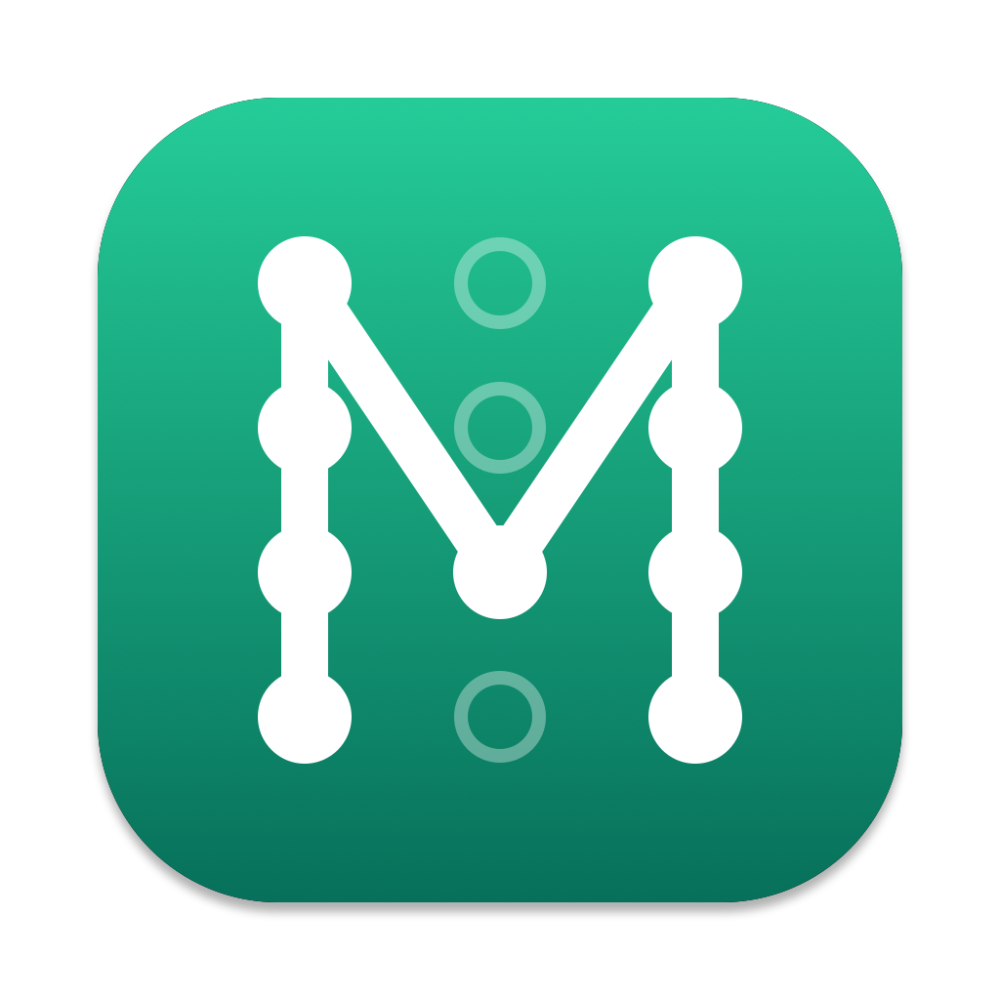

<p align="center"></p>

# MacroSIP

[English](README.md) · **Русский**

[](https://github.com/HSMM/MacroSIP/actions/workflows/ci.yml)
[](LICENSE)


SIP-софтфон для macOS на Apple Silicon и Intel в духе MicroSIP. Нативный интерфейс на
Swift и SwiftUI, движок [PJSIP](https://github.com/pjsip/pjproject) 2.17, без
Electron и Qt. Одно небольшое окно, значок в строке меню и всё, что умеет
настольный телефон: несколько аккаунтов, переводы и конференции, запись разговоров,
контакты со статусами, быстрые клавиши, глобальные горячие клавиши, интерфейс на английском и русском.

Руководство: https://hsmm.github.io/MacroSIP/wiki/ru/index.html

Статус: выпущена версия `26.3.0` (5 ноября 2026). Что дальше: [docs/ROADMAP.md](docs/ROADMAP.md).

## Скриншоты

Приложение следует оформлению macOS, и все картинки ниже переключаются вместе с ним (светлые и
тёмные кадры на двух языках лежат в [docs/screenshots](docs/screenshots)).

<p align="center">
  <picture><source media="(prefers-color-scheme: dark)" srcset="docs/screenshots/ru/dark/dialpad-calls.png?v=3"></picture>
  <picture><source media="(prefers-color-scheme: dark)" srcset="docs/screenshots/ru/dark/contacts-presence.png?v=3"></picture>
  <picture><source media="(prefers-color-scheme: dark)" srcset="docs/screenshots/ru/dark/call-recording.png?v=3"></picture>
</p>

<p align="center">
  <picture><source media="(prefers-color-scheme: dark)" srcset="docs/screenshots/ru/dark/conference.png?v=3"></picture>
  <picture><source media="(prefers-color-scheme: dark)" srcset="docs/screenshots/ru/dark/directory-search.png?v=3"></picture>
</p>

Меню аккаунтов: выбор исходящего аккаунта, включение и выключение аккаунтов. Слева светлая тема, справа тёмная:

<p align="center">
  
  
</p>

Настройки: глобальные горячие клавиши (Звонки) и группа «Устранение неполадок» с режимом отладки (Основные › Дополнительно):

<p align="center">
  <picture><source media="(prefers-color-scheme: dark)" srcset="docs/screenshots/ru/dark/settings-hotkeys.png?v=3"></picture>
  <picture><source media="(prefers-color-scheme: dark)" srcset="docs/screenshots/ru/dark/settings-diagnostics.png?v=3"></picture>
</p>

<p align="center">
  <picture><source media="(prefers-color-scheme: dark)" srcset="docs/screenshots/ru/dark/settings-recording.png?v=3"></picture>
</p>

Импорт из MicroSIP с предварительным просмотром и окно входящего звонка с автоответом:

<table align="center"><tr>
<td valign="middle"><picture><source media="(prefers-color-scheme: dark)" srcset="docs/screenshots/ru/dark/import-microsip.png?v=3"></picture></td>
<td valign="middle"><picture><source media="(prefers-color-scheme: dark)" srcset="docs/screenshots/ru/dark/incoming-auto-answer.png?v=3"></picture></td>
</tr></table>

Сообщения: список переписок и открытая переписка:

<p align="center">
  <picture><source media="(prefers-color-scheme: dark)" srcset="docs/screenshots/ru/dark/messages-list.png?v=3"></picture>
  <picture><source media="(prefers-color-scheme: dark)" srcset="docs/screenshots/ru/dark/messages-conversation.png?v=3"></picture>
</p>

## Возможности

**Звонки**

- До четырёх звонков одновременно: ответ, удержание, отключение микрофона, DTMF (автоматически: RFC 2833 с запасным вариантом SIP INFO; либо только RFC 2833, только SIP INFO, in-band), слепой и сопровождаемый перевод, локальная конференция (объединение включает удержанные звонки).
- Индикатор качества связи по RTCP с предупреждением о плохом соединении; громкость динамика и микрофона для каждого звонка, громкость рингтона.
- Входящие: окно звонка и уведомление; второй звонок во время разговора либо объявляется коротким сигналом и окном (ожидание вызова), либо отклоняется с 486 Busy (режим одного звонка); при желании главное окно выходит на передний план.
- Автоответ: выключен, на все звонки или только от контактов, с задержкой; с вашей АТС задержку задаёт заголовок `Call-Info: answer-after`.
- Отклонение входящих от никого, от всех, от номеров не из контактов или от анонимных абонентов; «Не беспокоить», в том числе на 30 минут, на час или до 9:00 завтра.
- Журнал звонков с воспроизведением записей; ссылки `sip:`, `sips:` и `tel:` открываются в приложении.

**Сообщения**

- Отправка и приём текстовых сообщений по SIP `MESSAGE` (`text/plain`, UTF-8, кириллица включена); SMS, которые пересылает Asterisk через `chan_dongle`, приходят как обычные сообщения.
- По умолчанию выключено: включите «Текстовые сообщения (SIP MESSAGE)» в Настройки › Основные; пока они выключены, вкладки «Сообщения» нет, а входящие сообщения игнорируются.
- Вкладка «Сообщения» с переписками, которые сохраняются между запусками; счётчик непрочитанных на вкладке и на значке в Dock, уведомления macOS и необязательный звук (Настройки › Звук › События звука: «Новое сообщение»).
- У каждого исходящего сообщения виден статус: «Отправлено» означает, что SIP-сервер или собеседник принял сообщение, но не то, что телефон его получил; «Не отправлено» показывает причину SIP и кнопку «Повторить».
- «Написать сообщение» в меню контактов и журнала звонков; до 2800 байт на сообщение.
- Не входит: групповой чат, вложения, индикаторы набора, сквозное шифрование.

**Аккаунты и сеть**

- Несколько SIP-аккаунтов с одновременной регистрацией; UDP, TCP и TLS с проверкой сертификата; SRTP; STUN и ICE; аккаунты «только исходящие»; каждый аккаунт включается и выключается в меню аккаунтов; поиск и сводка состояния, когда аккаунтов много. Пароли хранятся в связке ключей.
- Аккаунт на сервере с частным IP-адресом (10.x, 172.16–31.x, 192.168.x, 100.64–127.x, в локальной сети или через VPN) не использует STUN: первый REGISTER несёт собственный адрес Mac.
- IPv6 наряду с IPv4: SIP по UDP, TCP и TLS и звук по IPv6 для сервера, заданного IPv6-адресом или именем хоста с IPv6-записями (AAAA). У каждого аккаунта протокол IP: «Авто» (IP-адрес сам задаёт протокол, для имени хоста — порядок, который выдаёт macOS, а если сервер не отвечает, другой протокол), «Только IPv4» или «Только IPv6». По IPv6 нет STUN; ICE работает и по IPv6.
- После обрыва сети, смены IP или сна аккаунты сразу регистрируются заново, пока сети нет, попытки повторяются с нарастающей паузой; идущий разговор переживает смену IP. В строке состояния и в окне звонка видны «Нет сети» и «Переподключение…».
- Раздел «Сеть»: диапазон портов RTP, rport, DNS SRV с собственным сервером имён.
- Кодеки: Opus (с FEC и DTX), G.722, G.711 и, выключенные до включения вами, G.722.1, GSM, iLBC и Speex.
- Индикатор голосовой почты (MWI) по каждому аккаунту: значок в строке состояния и звонок на номер голосовой почты в один клик.

**Контакты, статусы и справочник**

- Карточка контакта с фото, организацией, несколькими номерами с подписями, e-mail и заметками; избранное; сортировка по имени или по фамилии; импорт из программы «Контакты» macOS.
- Статусы: следите за контактами и публикуйте свой статус (Доступен, Отошёл, Не беспокоить).
- Справочник пользователей: LDAP, URL (CSV или JSON), Google Контакты или программа «Контакты» macOS; подсказки в поле номера, поиск входящих по номеру, только поиск или импорт в контакты.

**Запись**

- Запись разговоров в M4A (AAC), моно или стерео (вы в левом канале, собеседник в правом); автоматическая запись всех звонков; папку выбираете сами.
- Необязательный тон уведомления каждые несколько секунд, который слышат обе стороны.

**Быстрые клавиши и глобальные горячие клавиши**

- Быстрые клавиши: до 12 клавиш быстрого набора с BLF в панели рядом с главным окном или под ним; типы «Звонок», DTMF, слепой и сопровождаемый перевод, добавление в конференцию; щелчок по мигающей клавише набирает код перехвата; ⌘1–⌘9.
- Глобальные горячие клавиши (по умолчанию выключены): ответ, завершение звонка и отключение микрофона из любого приложения; сначала ⌃⌥A, ⌃⌥H и ⌃⌥M, каждое сочетание можно сменить или очистить; разрешений системы не требуется.

**Импорт из MicroSIP**

- Настройки › Аккаунты › Импорт из MicroSIP…: аккаунты и контакты из `MicroSIP.ini` и `Contacts.xml` с предварительным просмотром. Импортированные аккаунты приходят выключенными и ждут паролей (пароли MicroSIP прочитать нельзя).
- Для скриптов и MDM: `/Applications/MacroSIP.app/Contents/MacOS/MacroSIP --import-microsip MicroSIP.ini [--contacts Contacts.xml] [--data-dir DIR] [--dry-run]`.

**Строка меню, «Не беспокоить», ссылки**

- Значок в строке меню с состоянием регистрации, быстрым набором, последними звонками, «Не беспокоить», вашим статусом и голосовой почтой; приложение работает и с закрытым окном.
- Запуск при входе; значок в Dock можно скрыть.

**Звук**

- Микрофон, динамик и устройство для рингтона выбираются отдельно; при подключении гарнитуры приложение переключается на неё, а при отключении возвращается.
- Эхоподавление (на устройствах по умолчанию с голосовой обработкой Apple и подавлением шума, на остальных встроенный эхоподавитель).
- Музыка на удержании для собеседника: встроенная мелодия, свой файл или тишина.
- Кнопки USB-гарнитуры (ответ, завершение, микрофон, повторный набор) с индикаторами; звуковые события; проверка звука с индикатором микрофона.

**Языки, темы, обновления**

- Интерфейс на английском и русском, светлая и тёмная темы.
- Обновление из приложения через Sparkle: проверка при запуске и раз в день, предварительные версии по желанию.
- Универсальное приложение для Apple Silicon и Intel.

## Установка

Нужен macOS 14 или новее на Apple Silicon или Intel. Приложение и DMG универсальные
(одна загрузка для обеих архитектур).

### Через Homebrew

```sh
brew tap hsmm/tap
brew install --cask hsmm/tap/macrosip
```

### Из DMG

1. Скачайте `MacroSIP-<версия>.dmg` из
   [последнего релиза](https://github.com/HSMM/MacroSIP/releases/latest).
2. Откройте образ и перетащите MacroSIP в папку «Программы».
3. Первый запуск: приложение подписано ad hoc (без нотаризации), поэтому macOS
   сначала откажется его открыть. Нажмите правой кнопкой на MacroSIP в папке
   «Программы», выберите «Открыть» и подтвердите, либо один раз выполните
   `xattr -dr com.apple.quarantine /Applications/MacroSIP.app`.

### Обновления

Пока в Настройках › Основные › Обновления включено «Проверять обновления автоматически» (так по
умолчанию), MacroSIP проверяет их через несколько секунд после запуска и затем раз в день и спрашивает
перед установкой. MacroSIP › Проверить наличие обновлений… проверяет сразу. «Включать
предварительные версии» добавляет тестовые сборки следующей версии. Sparkle подписывает и проверяет
обновления перед установкой, а обновлённое приложение открывается без запроса первого запуска.
Установка через Homebrew обновляется так же. Приложение подписано ad hoc, поэтому после каждого
обновления macOS снова спрашивает доступ к микрофону; разрешите его ещё раз.

## Устранение неполадок

- Журнал: `~/Library/Logs/MacroSIP/MacroSIP.log` (три файла по 2 МБ, в режиме отладки по 8 МБ).
- Настройки › Основные › Дополнительно › Устранение неполадок:
  - **Открыть папку** показывает файлы журнала в Finder.
  - **Скопировать** (строка «Диагностика») копирует версии, аккаунты и настройки без паролей, чтобы вставить в сообщение об ошибке.
  - **Режим отладки** пишет в журнал гораздо больше подробностей, в том числе SIP-сообщения, без перезапуска; журнал растёт быстрее, поэтому выключите режим после отправки архива.
  - **Создать архив…** (строка «Архив для диагностики») сохраняет ZIP с файлами журнала, отчётом диагностики и не более чем пятью недавними отчётами о сбоях MacroSIP. Пароли, ответы digest-аутентификации, nonce и подобные секреты в копиях удалены; номера телефонов и адреса серверов остаются, поэтому отправляйте архив только тому, кому доверяете.
- Из Терминала `--log-level` от 0 до 6 задаёт подробность журнала PJSIP (или переменная окружения `MACROSIP_LOG_LEVEL`); явно заданный уровень сильнее переключателя режима отладки:

  ```sh
  /Applications/MacroSIP.app/Contents/MacOS/MacroSIP --log-level 5
  log show --last 10m --predicate 'subsystem == "com.hsmm.macrosip"' --info
  ```
- Сообщение отмечено «Отправлено», но телефон его не получил: «Отправлено» означает только то, что сервер принял сообщение. Доставка на мобильный зависит от сервера (chan_dongle, модема, оператора связи); проверьте журнал Asterisk.

Ошибки и пожелания: https://github.com/HSMM/MacroSIP/issues

## Сборка

Требования: macOS 14 или новее на Mac с Apple Silicon и Xcode Command Line Tools.
Полный Xcode и пакеты Homebrew не нужны: OpenSSL и Opus собираются из закреплённых
исходников вместе с PJSIP. Intel-часть (x86_64) универсальной сборки собирается
кросс-компиляцией на том же Mac.

```sh
git clone https://github.com/HSMM/MacroSIP.git
cd MacroSIP
scripts/build-pjsip.sh      # один раз собирает OpenSSL, Opus и PJSIP 2.17 для arm64 и x86_64 (около 5 минут)
swift build -c release      # собирает Swift-пакеты (родная архитектура)
scripts/make-app.sh         # собирает универсальное dist/MacroSIP.app (подпись ad hoc)
open dist/MacroSIP.app
scripts/make-dmg.sh         # по желанию: dist/MacroSIP-<версия>.dmg
```

Сборки подписаны ad hoc, поэтому при первом запуске macOS попросит подтвердить
открытие приложения от неустановленного разработчика. `scripts/make-app.sh debug` собирает родное
отладочное приложение, которое принимает `--mock-engine --demo-state <имя>` для скриншотов и ручных
проверок (см. [docs/DEVELOPMENT.md](docs/DEVELOPMENT.md)).

### Тесты

```sh
scripts/test.sh             # наборы Swift Testing (модульные тесты и тесты движка через loopback)
scripts/selftest-call.sh    # сквозной звонок на локальный pjsua: RTP в обе стороны, удержание,
                            # DTMF, запись и конвертация в M4A, статусы, конференция из двух ног,
                            # входящие звонки, переводы
```

## Выпуск релиза

Подробности в [docs/DEVELOPMENT.md](docs/DEVELOPMENT.md#releasing).

1. Поставить тег `26.3.0` (кандидаты: `26.3.0-rc.1`) и отправить его; версию приложение берёт из тега. Для финального релиза также обновить `Product.fallbackVersion`.
2. `.github/workflows/release.yml` собирает DMG, создаёт GitHub Release и добавляет его в ленту
   обновлений (`appcast.xml` в ветке `gh-pages`, подпись секретом Actions `SPARKLE_PRIVATE_KEY`;
   ADR 0013). Каждый релиз ставится на новый коммит, финальный после кандидата тоже.
3. Тот же workflow обновляет Homebrew cask в `HSMM/homebrew-tap` секретом `TAP_TOKEN`.
   В новом форке: создать публичный репозиторий `HSMM/homebrew-tap`, fine-grained personal access
   token с правами Contents read/write только на него и сохранить его как секрет Actions
   `TAP_TOKEN`. Без секрета шаг пропускается.

## Структура проекта

| Путь | Что |
|---|---|
| `Sources/CPJSUA` | C-прослойка над pjsua, единственное место с заголовками PJSIP |
| `Sources/MacroSIPCore` | Движок (аккаунты, звонки, конференция, запись, статусы), модели, хранилище |
| `Sources/MacroSIPApp` | Приложение на SwiftUI/AppKit |
| `Sources/macrosip-cli` | Телефон командной строки для самопроверки и отладки с АТС; также принимает `--import-microsip` |
| `docs/` | Дорожная карта, проектная документация, ADR, спецификация UI и макеты |
| `scripts/` | Сборка PJSIP, сборка приложения, DMG, иконка, appcast, обновление cask, тесты |
| `packaging/` | Entitlements, иконка, шаблон Homebrew cask |
| `.github/workflows/` | CI и релизные workflow |

Документация: [ROADMAP](docs/ROADMAP.md), [устройство движка](docs/ENGINE.md),
[спецификация UI](docs/design/SCREENS.md), [решения](docs/adr/).

## Поддержать проект

MacroSIP бесплатен и открыт. Если он экономит вам время, можно поддержать разработку донатом. QR-коды и готовые суммы: [страница доната](https://hsmm.github.io/MacroSIP/donate.html?lang=ru).

| Монета | Сеть | Адрес |
| --- | --- | --- |
| BTC | Bitcoin | `16GBSkVAY67ZbGdqxQE17vcZDiZdgn46Wf` |
| USDT | TRC-20 (Tron) | `TX2hHPpUKXnhCvMb8PWkjSUbnvQ2wxCJr1` |

## Лицензия

GPLv2 или новее, потому что PJSIP распространяется под GPLv2+. См. [LICENSE](LICENSE).
